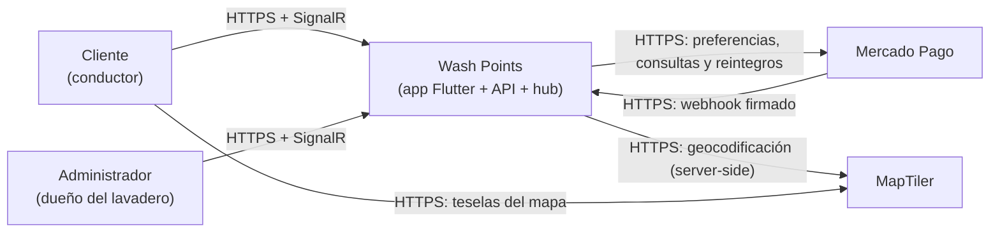
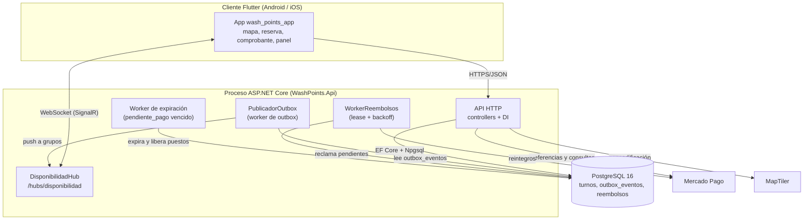
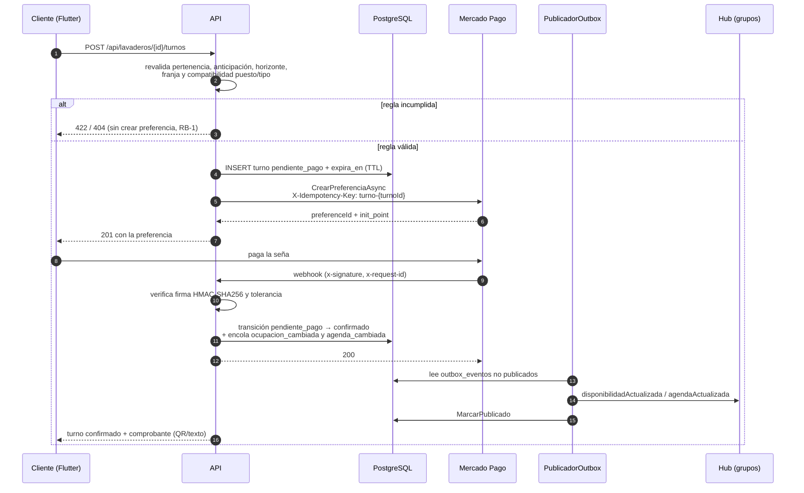
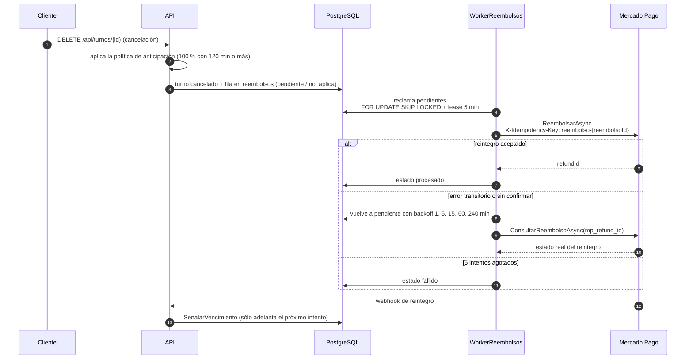
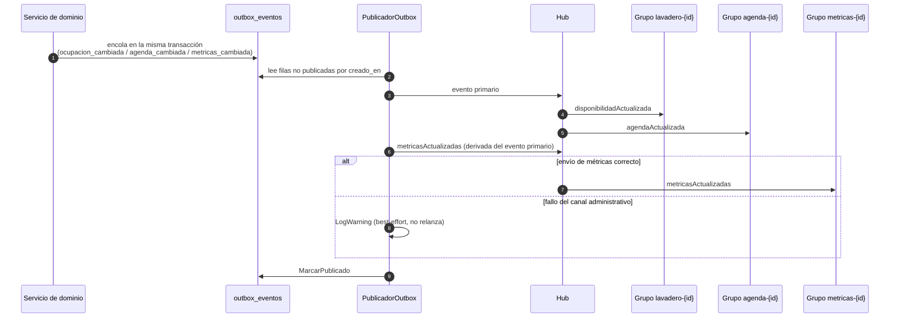
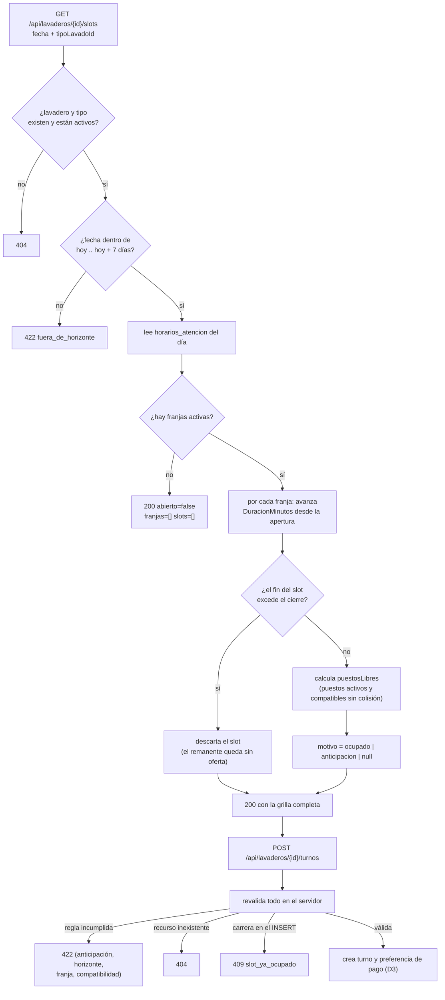
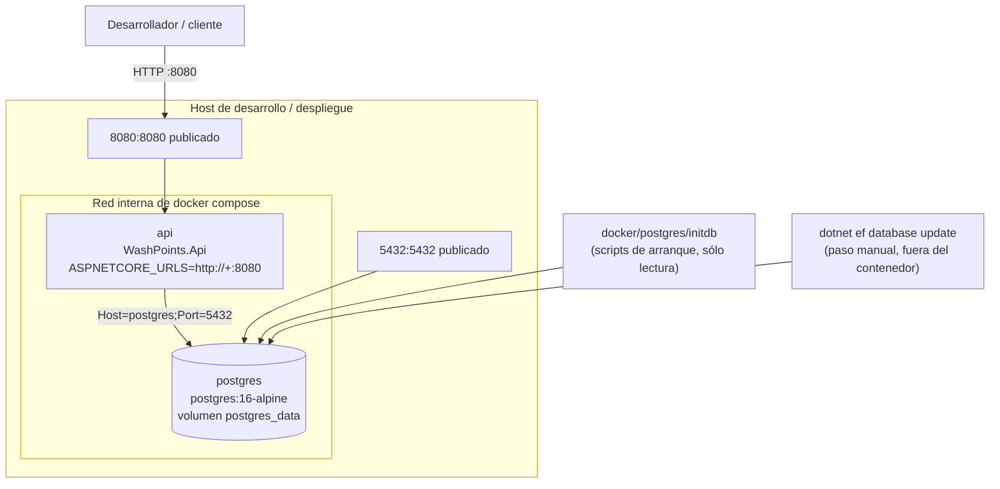
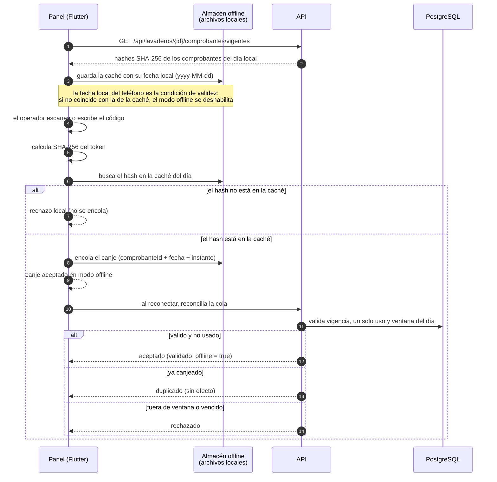

# Diagramas — Wash Points

Diagramas de contexto, contenedores, secuencias y despliegue del sistema. Son
una **vista** de la documentación, no una fuente de verdad: cada diagrama declara
su fuente y remite a la sección que manda.

## Convenciones

- Mermaid en un bloque por diagrama; sin estilos ad hoc (nada de `classDef`,
  `style` ni colores fijos), para que el render lo decida el tema del visor.
- Los identificadores de nodo son ASCII y sin espacios; las etiquetas con acentos
  van entre comillas dobles.
- Ningún nodo se llama `end`: es palabra reservada de Mermaid y rompe el bloque.
- Los diagramas **no duplican reglas de negocio**: describen el recorrido y
  remiten a `DOCS/ARCHITECTURE.md`.
- **Regla de mantenimiento:** si el código y el diagrama discrepan, gana el
  código y el diagrama se corrige en el mismo cambio.

## Tabla de revisión

| Diagrama | Última revisión | Slice que lo motivó |
|----------|-----------------|---------------------|
| D1–D2 | 2026-11-10 | slice-19 (cierre documental) |
| D3–D5 | 2026-11-10 | slice-19 (cierre documental) |
| D6 | 2026-11-10 | slice-19 (cierre documental) |
| D7 | 2026-11-10 | slice-19 (cierre documental) |
| D8 | 2026-11-10 | slice-19 (cierre documental) |

---

### D1 — Contexto del sistema

Fuente: [`OVERVIEW.md`](../OVERVIEW.md) §3 y §5; stack en
[`ARCHITECTURE.md`](./ARCHITECTURE.md) §2.

El cliente y el administrador son el mismo binario Flutter con distinto rol
(`ARCHITECTURE.md` §2). El webhook entra por HTTPS y se verifica antes de tocar
cualquier estado (§7.2). La key de teselas es pública y restringida; la de
geocodificación vive en el backend (§7.4).

---

### D2 — Contenedores

Fuente: [`ARCHITECTURE.md`](./ARCHITECTURE.md) §2.

El hub, los workers y la API comparten proceso y contenedor: no hay bus externo.
La outbox es una tabla, no un broker (`ARCHITECTURE.md` §7.3). El detalle del
fan-out está en D5.

---

### D3 — Reserva con seña

Fuente: [`ARCHITECTURE.md`](./ARCHITECTURE.md) §5, §7.2 y §7.3; RB-1 en
[`OVERVIEW.md`](../OVERVIEW.md) §4.3.

El turno **no** se confirma por el retorno del navegador: sólo por webhook
verificado o por la consulta de respaldo (`ARCHITECTURE.md` §7.2). La
máquina de estados está en §5.

---

### D4 — Reembolsos

Fuente: [`ARCHITECTURE.md`](./ARCHITECTURE.md) §7.2 (slice-14 y slice-15).

El webhook de reembolsos es una **señal**, no una fuente de verdad: el monto y el
estado salen siempre de la consulta a la pasarela (`ARCHITECTURE.md` §7.2).

---

### D5 — Fan-out de SignalR

Fuente: [`ARCHITECTURE.md`](./ARCHITECTURE.md) §7.3 y §7.6 (slice-18).

La pata de métricas va en su propio `try/catch`: **nunca** impide marcar la fila
ni publicar disponibilidad o agenda (RB-2 intacta). `metricas_cambiada` (cambios
de capacidad) se envía directo, sin evento primario. El detalle de los grupos y
la autorización está en `ARCHITECTURE.md` §7.3.

---

### D6 — Grilla de slots y revalidación de la reserva

Fuente: [`ARCHITECTURE.md`](./ARCHITECTURE.md) §7.5 (slice-17).

El ejemplo numérico de la grilla (franja de 4 h con duración de 45 min) está en
`ARCHITECTURE.md` §7.5. Una reserva inválida nunca crea una preferencia de pago
(RB-1).

---

### D7 — Despliegue

Fuente: [`ARCHITECTURE.md`](./ARCHITECTURE.md) §2 y
[`docker-compose.yml`](../docker-compose.yml).

`api` espera a que `postgres` esté *healthy* (`pg_isready`) antes de arrancar. Las
migraciones **no** se aplican al arrancar la API: se ejecutan como paso explícito
(`dotnet ef database update`). Los `appsettings*.json` se hornean en la imagen, así
que un cambio de configuración exige `docker compose build api`
(`AGENTS.md` §5.5).

---

### D8 — Canje offline

Fuente: `SPECS/slice-11-validacion-offline.md`;
[`ARCHITECTURE.md`](./ARCHITECTURE.md) §4.1 (invariante de canje único) y §10.4
(ventana de canje).

El comprobante se trata como credencial: el cliente nunca guarda el token claro,
sólo su hash (`AGENTS.md` §3.4). Un canje fuera de la ventana del día local no se
registra y, si se registrara, se rechazaría al reconciliar
(`ARCHITECTURE.md` §10.4).
